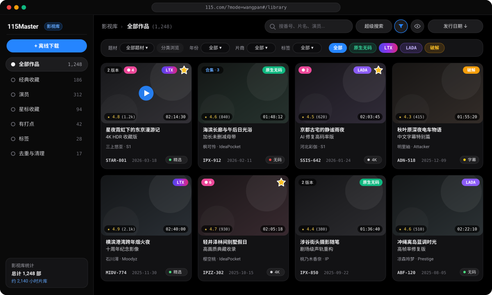

<div align="center">

<p></p>

<p></p>

[](https://github.com/amasun/115master/releases)
[](https://github.com/amasun/115master/releases)
[](https://amasun.github.io/115master/)
[](LICENSE)

</div>

基于 [daoran9/115master](https://github.com/daoran9/115master) v2 分支的个人增强版本，使用独立名称和更新源，不会被上游覆盖。

## 安装

```
https://github.com/amasun/115master/releases/latest/download/115master-fusion.user.js
```

需要 Tampermonkey 5.3.3+，Chrome 130+ 或 115Browser 35+，并开启扩展开发者模式。安装前停用原版 115Master，两者不能同时运行。

## 产品说明书（Wiki）

完整的功能介绍、快捷键说明与配置指南已发布至 GitHub Pages：

- 在线文档：<https://amasun.github.io/115master/>

## 三个界面的编号

脚本在三个界面里工作，下文和问题反馈里用编号称呼：

| 编号 | 界面 | 说明 | 代码位置 |
|---|---|---|---|
| **U1** | 115 旧版 | 115 官方旧版网盘页面，脚本往它的文件列表里注入内容 | `apps/monkey/src/pages/home` |
| **U2** | 115 新版 | 115 官方新版网盘页面，脚本往它的文件列表里注入内容 | `apps/monkey/src/pages/official` |
| **U3** | 影院模式 | 脚本自带的独立文件管理界面，不使用 115 的页面 | `apps/monkey/src/app`、`apps/monkey/src/pages/drive` |

## 界面预览（U3 影院）

<p align="center">
  
</p>

## 在上游基础上新增的功能

### 播放器打点（Markers）

看视频时把重要位置记下来，下次打开同一个视频还在，可以直接跳过去。打点只在 MASTER 播放器里可用。

<p align="center">
  
</p>

**能做什么**

- 在当前播放位置打点，并给它写备注
- 进度条上显示每个打点的刻度，悬停看备注，点击跳转
- 控制栏的打点按钮里有完整列表，可以跳转、改名、删除
- 用快捷键在打点之间前后跳转
- 打点按视频保存在浏览器本地，刷新或重新打开后自动恢复

**怎么用**

1. 用 MASTER 播放器打开视频。
2. 播放到想记录的位置，按 `B`，或点控制栏的打点按钮再点"在当前位置打点"。进度条上会出现一个刻度。
3. 点控制栏的打点按钮打开列表：点某一条跳到该位置；点改名后输入备注，回车保存，`Esc` 取消；点删除移除该打点。
4. 按 `,` 跳到上一个打点，按 `.` 跳到下一个打点。

| 操作 | 默认快捷键 |
|---|---|
| 在当前位置打点 | `B` |
| 上一个打点 | `,` |
| 下一个打点 | `.` |

快捷键可以在播放器的快捷键设置里修改。

**注意**

- 打点默认保存在浏览器本地，同时支持同步写入 **115 文件原生备注**；开启后换设备或重装浏览器，只要装好本插件即可自动恢复打点。
- 打点跟随视频文件本身，文件改名或移动后仍然有效。

**进行中**

- 正在针对打点和播放器的一系列交互体验问题做优化，界面和操作细节后续版本还会调整。
- 计划中：打开视频自动跳到首个打点、只播放打点片段的精华模式。

### 跨设备复用：哪些字段保存在 115 文件备注中

以下数据直接记录在 115 云端（文件原生备注 `file_desc` 或原生属性）中，**无需额外导入导出，换电脑/换浏览器只要安装好本插件并登录同一 115 账号即可自动复用**：

| 字段 | 在 115 中的存储位置 | 跨设备复用方式 |
|---|---|---|
| **片名备注** | 写入 115 文件原生备注顶部纯文本 | 新设备装好本插件打开作品详情时自动从 115 备注读取回填，且在 115 官方端可直接看到 |
| **播放器打点（时间点 + 备注）** | 以 `[115M:MARKERS:v1]...[/115M]` 区块无损附加在 115 文件原生备注末尾 | 新设备装好本插件打开视频播放时自动从 115 备注解析恢复并与本地合并（与片名备注、手写备注互不覆盖） |
| **星标收藏 & 115 网盘标签** | 115 官方原生云端字段 | 跟随 115 账号天然跨设备同步 |

> 其余纯本地数据（如**演员备注名**、演员收藏/隐藏、手动番号绑定、本地刮削缓存与自定义封面/头像等）可在偏好设置「缓存与数据同步」中导出为单个 `.115bak` 文件，在新设备一键导入迁移。

## 上游功能（概览）

以下功能来自上游项目，本仓库未修改：

- MASTER 文件管理器：列表/卡片视图、多选、搜索、移动、重命名、番号资料、演员头像
- 播放器：Ultra 原画、多画质、缩略图、字幕、播放列表、剧院/全屏/画中画、自定义快捷键
- 新版 115 页面接入：视频封面、番号资料、演员头像、播放入口、ED2K 链生成
- 增强开关：在偏好设置中独立控制各增强项

## 开发

```bash
pnpm install --frozen-lockfile
pnpm --filter @115master/monkey exec vitest run --project unit
pnpm --filter @115master/monkey type-check
pnpm --filter @115master/monkey build
```

产物：`apps/monkey/dist/115master-fusion.user.js`

## 贡献

原作者：[@cbingb666](https://github.com/cbingb666)  
Fusion 维护：[@daoran9](https://github.com/daoran9)  
本仓库：[@amasun](https://github.com/amasun)

参与开发请先阅读 [CONTRIBUTING.md](CONTRIBUTING.md)。

## 许可

[MIT](LICENSE) 许可证。

## 免责声明

本软件仅供技术研究与学习，使用者须遵守当地法律法规及 115 服务条款，自行承担使用风险。
