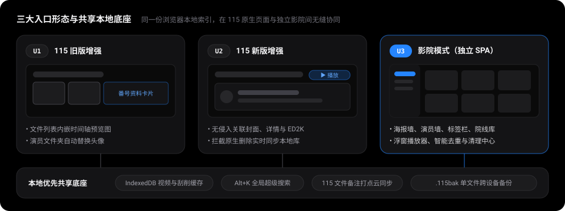
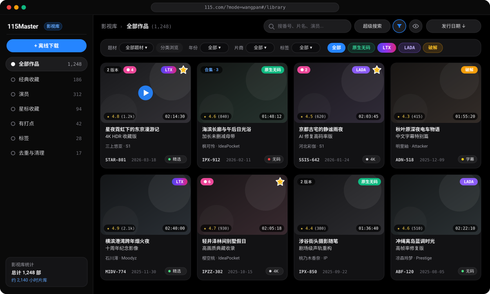
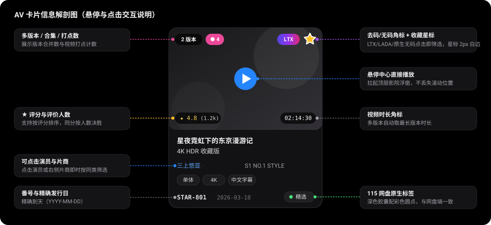
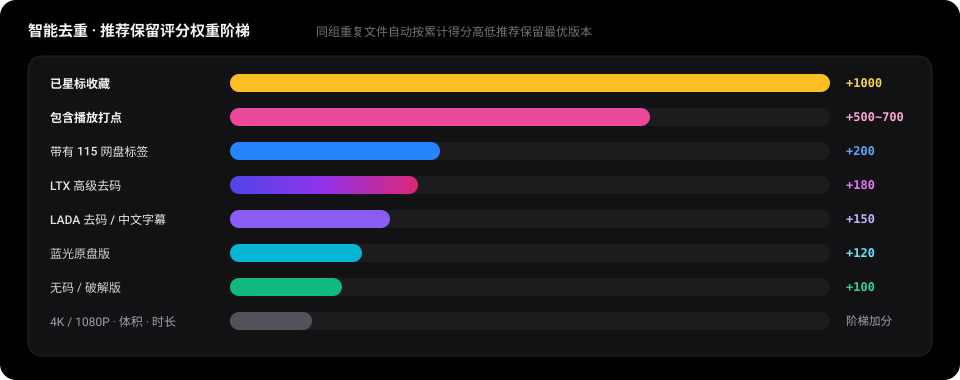
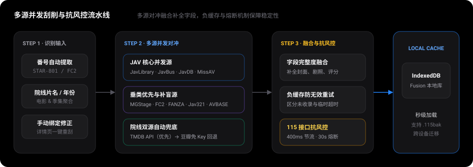

# 115master fusion+ 产品说明书（Wiki）

> **定位**：一款运行于浏览器的 Tampermonkey 用户脚本，在继承 `115master` 与 `115master-fusion` 原生网盘增强及 MASTER 播放器的基础上，构建了**本地优先、无中心后端的私人影视库、多源刮削引擎、全盘超级搜索、智能去重清理与跨设备备份体系**。

| 能力层级 | 核心内容 |
| :--- | :--- |
| **基础能力（来自上游 `115master` / `fusion`）** | U1 旧版 / U2 新版网盘增强、MASTER 播放器、多源字幕、基础番号刮削与 `gfriends` 头像、播放打点基础框架 |
| **`115master fusion+` 新增核心模块** | 番号影视/院线影视双库分流、TMDB+豆瓣双源刮削、全盘超级搜索、演员墙与资料栏、片名/演员备注、115 文件备注打点云同步、智能去重清理、`.115bak` 跨设备备份 |

---

## 目录导航

- [第 1 章：快速上手](/?id=ch1)
- [第 2 章：真影视库模式（Media Library）](/?id=ch2)
- [第 3 章：演员图片墙与个人资料](/?id=ch3)
- [第 4 章：标签栏与 115 网盘标签管理](/?id=ch4)
- [第 5 章：院线影视库（TMDB + 豆瓣双源）](/?id=ch5)
- [第 6 章：超级搜索（Super Search）](/?id=ch6)
- [第 7 章：MASTER 播放器、字幕与打点云同步](/?id=ch7)
- [第 8 章：去重与垃圾文件清理中心](/?id=ch8)
- [第 9 章：多源元数据刮削与抗风控体系](/?id=ch9)
- [第 10 章：115 原生页面增强（U1 旧版 & U2 新版）](/?id=ch10)
- [第 11 章：跨设备数据同步与偏好设置中心](/?id=ch11)
- [附录：快捷键速查表](/?id=shortcuts)

---

## 第 1 章：快速上手 :id=ch1

### 1.1 运行环境与安装
- **浏览器与管理器**：推荐使用 Chrome / Edge / Safari 配合 Tampermonkey（油猴）安装构建产物 `115master-fusion.user.js`。
- **三大入口形态**：
  1. **U1（115 旧版文件列表）**：顶部与文件列表内嵌增强入口。
  2. **U2（115 新版网盘页面）**：无侵入注入封面、资料卡片与快捷播放入口。
  3. **U3（影院模式 · 独立 SPA 界面）**：以深色「影视库」为主入口，提供完整桌面级观影与片库管理体验。

### 1.2 首次建立片库索引
1. 进入影视库后，若尚未建立本地视频索引，系统会引导选择 **AV / 番号影视目录** 与（可选的）**院线影视目录**；也可跳过直接全盘扫描。
2. 索引拉取完成后保存在本地浏览器 IndexedDB，后续打开影视库可秒级加载，无需重复拉取全盘列表。
3. 侧边栏底部「网盘索引」提供两种同步模式：
   - **增量同步**：仅拉取新入库视频（含时间窗口回溯），速度快且保留已刮削图文与封面。
   - **全量重建**：全盘重新扫描并与本地索引对齐。
4. 在影视库点击「离线下载」提交任务后，后台会自动触发增量同步与新片自动刮削。

---

## 第 2 章：真影视库模式（Media Library） :id=ch2

### 2.1 侧边栏导航与网址锚点
- **核心栏目**：`番号影视`、自定义栏目、`演员`、`星标收藏`、`有打点`、`标签`、`去重与清理`，以及独立分流的 `院线影视`。
- **URL 锚点同步**：每个栏目与状态均同步到哈希路由（如 `#/library?view=starred`、`#/library?view=cinema`、`#/library?tags=1`、`#/library/cleanup?tab=junk`），刷新页面或使用浏览器前进/后退均可精确回到原栏目。
- **右键快捷菜单**：在「番号影视」「院线影视」或自定义栏目上右键，可直接配置扫描目录、全量重建索引或编辑/删除栏目。

### 2.2 预估总时长统计与片库彩蛋
- 侧边栏底部「网盘索引」部数后的 `i` 图标支持悬停查看**预估总时长统计卡片**：
  - **真实片长汇总**：剧集（`tv`）与目录合集（`collection`）累加其下全部文件时长；单部作品取多版本中最长文件时长（回退刮削片长），并单独统计缺失时长元数据的部数。
  - **分类明细**：分别展示 `AV 作品`、`院线影视`、`合集 / 其他` 及各 `自定义栏目` 的部数与累计时长。
  - **片库彩蛋称号**：根据 AV 时长、院线时长、合集占比与总量级，自动匹配 13 档风趣称号与吐槽评语（如 `雅俗共赏·双料宗师`、`深夜人类学研究员`、`私人放映厅主理人`、`营养快线 VIP 股东`、`仓鼠系合集收藏家`、`赛博亚历山大图书馆长` 等）。

### 2.3 海报墙与 AV 卡片信息
- **分页与按需加载**：支持配置每页显示 `24 / 48 / 60 / 96 / 120` 部，结合视口按需加载封面；翻页时自动释放 Blob URL、取消旧页在途请求与刮削任务，保障万级片库流畅度。
- **智能双页裁切**：竖版海报模式下自动识别非 FC2 双页封套并右半裁切。
- **AV 卡片信息布局**：
  - **封面角标**：左上角展示合集/多版本数与打点数；右上角展示 **LTX / LADA / 无码 / 破解** 五档来源角标（支持直接点击按同类筛选，有码作品无标签；当有码厂商与文件名关键词或手动「无码」标签冲突时自动归为 `破解`，`-U`/`-UC`/`uncensored` 在原生无码番号下仅作验证仍标为 `无码`）与**星标收藏**（2px 白色描边）；左下角展示 **★ 评分与评价人数**；右下角展示片长；悬停封面中心浮现「直接播放」。
  - **卡片文字区**：标题（两行省略）、**演员与发行商/片商行**（最多显示 2 位优先女演员，点击即按演员筛选；右侧展示发行商/片商，点击即按片商筛选）、题材胶囊（最多 3 枚，点击即筛选）、底栏番号与**精确到天的发行日期**（`YYYY-MM-DD`）。

### 2.4 多维搜索、排序与分组筛选
- **顶部即时搜索**：支持按番号、片名、文件名、演员（含别名）、导演、题材、片商/发行商、网盘标签搜索，并内置**无码语义索引**（搜索 `ltx`、`lada`、`无码`、`去码`、`破解`、`uncensored` 等可直接命中对应来源条目）。
- **排序方式**：支持按 `最近入库`、`发行日期`、`评分`（无评分排在末尾，同分按评价人数决胜）、`片长`、`文件大小`、`番号 / 名称` 升/降序排列。
- **多维筛选面板（FilterBar）**：
  - **题材分组筛选**：下拉框按 `主题 / 角色 / 服装 / 体型 / 行为 / 玩法 / 其他` 7 大分组呈现；点击「分类浏览」可展开标签页可视化点选。
  - **组合条件**：支持 `年份`、`导演`、`片商`、`网盘标签`、`刮削状态`、`仅看星标`、`仅看有打点`、`LTX`、`无码` 一键切换。
  - **隐藏疑似广告视频**：内置时长与体积阈值（支持 `且 AND / 或 OR` 规则，并与清理中心实时同步）。
- **面包屑导航**：顶部面包屑完整展示当前筛选层级（如 `番号影视 > 片商：S1 > 演员：...` 或 `院线影视 > 科幻 > ...`），支持点击任意上级快速回退。

### 2.5 作品详情页与智能目录合集
- **详情页能力**：展示海报/封面、来源/手动匹配/版本数/LTX 及无码来源徽章、评分与评价人数、发行日期、导演、片商、题材胶囊、演职员横排（已收藏演员姓名后带红心标记）、剧照预览画廊（支持 PhotoSwipe 放大）与本地时间分段截图。
- **多版本文件管理**：支持切换播放版本、查看文件所属 `LTX / LADA / 无码 / 破解` 标记、开启「去重管理」勾选保留/删除多余版本、右键重命名/移动/星标/打标签/打开所在目录。
- **手动绑定番号、片名备注与自定义封面**：支持为未识别或误识别文件手动绑定番号并触发刮削，支持在详情页或卡片右键编辑**片名备注**（支持一键同步写入 115 原生文件备注字段并与打点云同步无损共存，且支持顶部搜索与 `.115bak` 备份），也支持从多源候选切换封面或上传本地图片。
- **智能目录合集**：同一非根目录文件夹下有 `>= 2` 个无番号非院线视频时自动聚合为「目录合集」，支持合集列表排序连播、自定义标题/简介/标签/创作者编辑，以及一键「拆分为独立视频」或「恢复为目录合集」。

### 2.6 自定义侧边栏目
- 支持在设置或侧边栏新建自定义栏目，绑定一个或多个 115 目录，并独立配置该栏目的刮削模式：**番号刮削（JAV）**、**院线刮削（TMDB/豆瓣）**、**目录合集** 或 **纯本地平铺**。

---

## 第 3 章：演员图片墙与个人资料 :id=ch3

- **演员聚合墙**：自动统计本库演员作品数、已刮削数、打点数、总体积与最近入库时间；默认按女演员筛选，支持切换「全部 / 女演员 / 男演员 / 未标注」，支持右键手动修正性别并持久化。
- **收藏、备注与隐藏**：支持收藏心仪演员（置顶或高亮红心）、在演员卡片右键或个人资料侧栏添加**演员备注名**（记录曾用名、外貌特征等，支持演员页与顶部片库搜索及 `.115bak` 备份）、隐藏不想展示的演员并在「隐藏」标签查看或恢复。
- **演员个人资料侧栏（Actor Profile Rail）**：选中演员查看作品墙时，右侧展示其头像（支持多源匹配与本地上传）、生日、年龄、身高、罩杯、三围、出生地、爱好、曾用名别名，以及本库网盘标签与常拍题材联动筛选。
- **多源资料兜底**：按 `JavBus → AVBASE → MINNANO-AV` 顺序自动拉取并本地缓存 30 天。

---

## 第 4 章：标签栏与 115 网盘标签管理 :id=ch4

- **平行标签栏（Tag Rail）**：点击侧边栏「标签」在主侧栏右侧展开平行面板，打开时自动切换至全量 AV 数据库并保持 `#/library?tags=1` URL 锚点；点击侧边栏其他栏目时自动收起。
- **浏览筛选**：支持搜索标签、切换「仅看有作品」，点击标签即时筛选对应 115 网盘标签作品。
- **标签管理模式**：点击头部「管理」可直接在影视库内新建、编辑（名称/颜色）、删除或勾选批量删除 115 原生标签，无需跳回官方网盘页面。

---

## 第 5 章：院线影视库（TMDB + 豆瓣双源） :id=ch5

!> **重要提示：请务必将普通电影 / 剧集配置到「院线影视目录」中！**  
!> 插件采用**按目录隔离刮削策略**：只有归属于**「院线影视目录」**（或刮削模式设为「院线刮削」的自建栏目）的视频才会触发 TMDB / 豆瓣电影与剧集刮削。  
!> 若将院线电影/剧集放在**「番号影视」（默认 / AV 目录）**中，**不会**自动识别为院线影视刮削——单部无番号电影会保留为普通本地文件，同目录下多集剧集会被自动聚合为「目录合集」并跳过刮削（以避免误刮杂项视频）。

- **完全隔离的独立栏目（默认开启）**：侧边栏默认启用并独立展示「院线影视」栏目（可在偏好设置或侧栏右键随时关闭），只需在「院线影视目录」中指定电影/剧集所在文件夹即可自动归类，不混入「番号影视」与「演员」墙，默认采用 `2:3` 竖版海报展示。
- **电影 / 剧集自动聚合**：自动解析文件名与父目录名中的影视名称、年份与季集信息（剧集自动聚合多集文件）。
- **双源自动刮削**：优先使用 **TMDB API**（设置面板「TMDB API Key」旁提供 **`免费申请 ↗`** 直达链接，支持 v3 Key / v4 Token 与自定义反代地址），TMDB 未命中、超时或受限时自动回退 **豆瓣免 Key** 接口补全海报、评分、简介、导演与演职员。

---

## 第 6 章：超级搜索（Super Search） :id=ch6

- **全局快捷键 `Alt + K`**：在 U1 / U2 / U3 任意端一键唤起，直接检索本地全盘视频索引。
- **多线索秒级匹配**：支持番号、片名、文件名、演员名及中日文曾用名别名联合匹配。
- **创作者平台专属识别**：内置 `OnlyFans` / `MyFans` 特征识别与防番号误提取规则，支持 `@账号`、`of:`、`mf:`、`dir:` 前缀过滤及来源平台胶囊。
- **父目录索引与原生兜底**：支持按安全节流索引视频父目录路径（断点续传 + 防风控）；本地未命中时支持一键调用 115 原生搜索兜底。

---

## 第 7 章：MASTER 播放器、字幕与打点云同步 :id=ch7

- **双重播放体验**：在影视库内点击播放拉起顶层**影院浮窗播放器**（不丢失当前筛选与滚动位置），同时保留独立播放页与右侧影片详情侧栏。
- **播放核心**：基于 `@libmedia/avplayer` + `hls.js` 支持 Ultra 原画直链与多档画质切换、倍速、比例/旋转、画中画、剧院模式、进度条缩略图预览与画面增强滤镜。
- **多源字幕自动匹配**：内置 `Thunder`（迅雷）、`SubtitleCat`、`AvSubtitles`、`Aiyi` 四大字幕来源，支持自动搜索、挂载外挂字幕与时间轴偏移微调。

  <iframe src="demos/master-player-prototype.html" title="MASTER 播放器交互原型" style="width: 100%; height: 540px; border: 0; display: block;" loading="lazy"></iframe>

> 可直接在上方原型中点击播放/暂停、拖动进度条预览、切换画质/字幕/倍速、按 `B` 打点或按 `,` / `.` 跳转，也可以 [在新标签页全屏体验 MASTER 播放器原型 ↗](demos/master-player-prototype.html ':ignore')。

- **播放打点（Fusion Markers）**：
  - 播放时按 `B` 键打点并填写备注，进度条实时渲染刻度与悬停预览；按 `,` / `.` 快速在打点间跳转。
  - **115 文件备注云同步**：开启后自动将打点以 `[115M:MARKERS:v1]...[/115M]` 区块无损写入 115 文件原生备注（与片名备注/手写备注互不覆盖），换浏览器/换设备装好本插件即可自动恢复。

---

## 第 8 章：去重与垃圾文件清理中心 :id=ch8

- **智能异步重复分析**：后台分片扫描全库，识别 4 类重复组：
  1. `SHA1` 完全相同文件；
  2. 同番号多文件（自动识别 `cd1/cd2` 多集分卷，防止误删）；
  3. 蓝光版与普通版映射；
  4. 无番号相似视频（同目录或同体积同片长）。
- **智能保留评分推荐**：按 `已星标 (+1000) > 有打点 (+500~700) > 有网盘标签 (+200) > LTX 高级去码 (+180) > LADA 去码 (+150) > 中文字幕 (+150) > 蓝光版 (+120) > 无码/破解 (+100) > 4K/1080P > 体积 > 时长` 自动推荐保留最优版本。

- **无效索引 / 广告与垃圾文件扫描**：按自定义时长/体积阈值扫描疑似广告视频及非媒体垃圾文件，支持批量勾选、安全删除（分批/逐目录降级、实时进度、随时中止、风控错误透出）。

---

## 第 9 章：多源元数据刮削与抗风控体系 :id=ch9

- **多源并发对冲与融合（JAV）**：
  - 核心源：`JavLibrary`、`JavBus`、`JavDB`、`MissAV`。
  - 通用补盲源：`Jav321`、`AVBASE`。
  - 垂类优先源：`MGStage`（`SIRO/LUXU/MIUM/ABW` 等）、`FC2Official`、`FD2PPV`。
  - 可选官方源：`FANZA / DMM`（可在设置中按需启用，日区 IP 下优先获取无水印大图与完整字段）。
- **字段融合与负缓存**：同一番号多源并发抓取后按完整度融合写入本地 `Fusion` 缓存；区分「未收录（负缓存避免无效重试）」与「风控/挑战/超时（允许后续重试）」。
- **115 接口抗风控**：父目录路径反查与批处理采用串行节流 + 400ms 间隔 + 触发风控 30 秒全局熔断退避。

---

## 第 10 章：115 原生页面增强（U1 旧版 & U2 新版） :id=ch10

- **U1 旧版增强**：文件列表内嵌多格时间轴预览图、番号资料卡片（宽大/紧凑切换）、演员文件夹头像替换。
- **U2 新版增强**：无侵入关联新版列表数据，补充封面、资料卡片、演员头像、MASTER 播放入口与 ED2K 一键生成。
- **原生删除实时联动**：拦截 115 原生页面的 `/rb/delete` 删除请求，在原生页删片后立即同步移除本地视频索引并跨标签通知影视库刷新。

---

## 第 11 章：跨设备数据同步与偏好设置中心 :id=ch11

- **115 云端原生复用（无需导入导出，装好插件即自动恢复）**：

| 字段 | 存储位置 | 跨设备复用方式 |
| :--- | :--- | :--- |
| **片名备注** | 115 文件原生备注顶部纯文本 | 新设备打开作品详情自动读取回填，115 官方端直接可见 |
| **播放器打点（时间点 + 备注）** | 115 文件原生备注末尾 `[115M:MARKERS:v1]` 区块 | 新设备打开视频自动解析恢复，与片名备注互不覆盖 |
| **星标收藏 & 115 网盘标签** | 115 官方原生云端字段 | 跟随 115 账号天然跨设备同步 |

- **`.115bak` 单文件二进制备份（本地扩展数据迁移）**：在偏好设置「缓存与数据同步」中可将本地视频索引、JAV/院线刮削元数据、未命中记录、演员资料、**演员备注名**、演员收藏/隐藏、手动番号绑定、目录路径缓存及可选的自定义封面/头像与缩略图打包为单个 `.115bak` 文件，在其他设备一键合并导入（兼容旧版 `.json`）。
- **孤立刮削缓存清理**：一键比对本地视频索引，清理在 115 原生端删片后残留的孤立刮削缓存、未命中记录与海报缩略图。
- **目录跳转版本切换**：可设置「打开所在目录」默认跳转 **新版 115** 或 **旧版 115**。
- **外观与布局**：支持深色/浅色/跟随系统主题、海报宽高比（横版/竖版）、网格密度与每页数量设置。

---

## 附录：快捷键速查表 :id=shortcuts

| 场景 | 快捷键 | 说明 |
| :--- | :--- | :--- |
| 全局 / 网盘 / 影视库 | `Alt + K` | 打开「超级搜索」面板 |
| 播放器 | `B` | 在当前播放时间点添加打点 |
| 播放器 | `,` / `.` | 跳转到上一个 / 下一个打点 |

*(注：播放器内的播放/暂停、快进退、音量、全屏等按键可在播放页快捷键设置中自定义。)*
