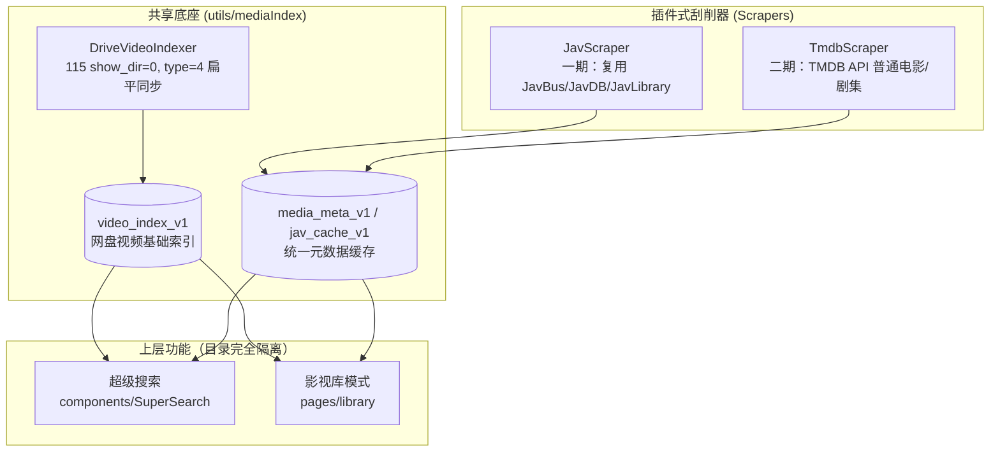

# 115Master Fusion「影视库模式（Media Library）」产品与技术说明书

> **文档状态**：草案 v1.0  
> **适用范围**：U3 Fusion 独立应用新增核心路由 `/#/library`（与文件管理 `/#/drive` 并列，U1/U2 顶栏提供直达入口）  
> **核心目标**：基于 115 网盘文件索引、外部刮削源与本地缓存数据，将 115 网盘转化为类似 Emby / Jellyfin / Infuse 风格的私人影视库——支持海报墙、多维分类筛选、演员墙、影片详情页、一键播放，并面向**番号影视 + 普通电影/剧集**两类资源统一建模（一期交付番号影视，二期扩展普通影视）。

---

## 一、产品背景与定位

当前 115Master Fusion 已具备成熟的 U3 文件管理（`/#/drive`）与 MASTER 播放器（`/#/video`），但本质上仍是以“目录树 + 文件列表”为中心：
- **目录割裂**：同演员、同题材、同年份的作品往往分散在多个不同日期或来源的子目录中，无法按内容维度沉浸浏览。
- **元数据利用率低**：本地已积累了大量 `javCache`（封面、演员、分类、导演）、`actressFaceDB`（演员头像）、`videoCoverCache`（时间轴截图）和 `markerStore`（播放打点），但仅在打开具体文件夹时零星展示。
- **多类型资源并存需求**：用户的网盘里通常同时存在**番号影视**与**普通电影/剧集**，需要一套可扩展的统一影视库框架，在同一个界面里按媒体库分区清晰管理。

---

## 二、产品设计

### 2.1 架构形态：作为 Fusion 独立路由接入（不拆独立脚本）

- **统一入口**：在 U3 Fusion 顶栏/侧边栏新增「影视库（`/#/library`）」导航项，与「文件管理（`/#/drive`）」平级切换；U1/U2 页面可通过 Fusion 入口直达。
- **零侵入与按需初始化**：未进入 `/#/library` 路由时，影视库模块不初始化状态、不占用列表页内存；同时可在偏好设置中提供开关控制入口显隐。
- **媒体库分区（Library Tabs）**：
  - **全部 / 番号影视**（一期默认启用）
  - **普通电影 / 剧集**（二期接入 TMDB 刮削源后启用，支持用户按网盘根目录绑定媒体库类型，例如 `/AV` → 番号库、`/Movies` → 普通影视库）

### 2.2 四大核心视图（主流影视库排版）

#### 1. 影视库大厅（`/#/library`）
- **Hero 大图横幅**：展示最新入库或随机精选的高清封面、片名、年份、演员/标签摘要，提供大号 **「立即播放」** 与 **「查看详情」** 按钮。
- **横向专题推荐行**：
  - **最近入库**：按网盘入库时间降序展示；
  - **有打点的影片**：直接关联本地 `markerStore`，一键续看或直达高光片段；
  - **常看演员**：按本地收藏作品数排序的圆形演员头像条；
  - **热门题材分类**：自动汇总本地收藏量最高的标签专题。

#### 2. 全部影片海报墙（`/#/library/all`）
- **自适应海报网格**：支持横版封面（适合番号宽封面）与竖版海报（适合二期普通电影海报）两种卡片比例切换，支持网格密度调节。
- **多维组合筛选栏（纯本地毫秒级过滤）**：
  - 媒体类型：`全部 / 番号影视 / 普通电影（二期）`
  - 维度筛选：`演员`、`题材/分类标签`、`导演`、`发行年份`、`时长区间`、`刮削状态（已刮削 / 待刮削）`、`是否有打点`
  - 排序方式：`最近入库`、`发行日期`、`片长`、`文件大小`、`番号/名称`
- **多版本聚合**：同一作品（相同 `avNumber` 或 `tmdbId`）在网盘中存在多个版本（如原画 + 字幕版）时，在海报墙聚合为单张卡片，角标显示版本数，详情页可自由切换播放版本。

#### 3. 演员墙（`/#/library/actors`）
- 自动统计网盘中所有已刮削作品的演员集合，优先匹配 `actressFaceDB` 展示高清圆形头像与「已收藏 X 部」。
- 支持按作品数量 / 首字母排序与快速搜索，点击演员卡片直接进入该演员的专属作品海报墙。

#### 4. 影片详情页（`/#/library/item/:mediaKey`）
- **沉浸式头部**：大图背景高斯模糊 + 高清主封面 + 片名、编号/年份、时长、文件大小、导演、题材标签胶囊。
- **演员横排**：圆形头像 + 姓名，点击跳转该演员作品页。
- **版本与文件信息**：列出该作品对应的全部网盘文件（文件名、大小、清晰度、所在目录），支持一键 **「MASTER 播放」** 或 **「在文件管理中打开目录」**。
- **预览与打点联动**：
  - 直接内嵌复用 `ExtVideoCover` 时间轴预览截图条（命中 `videoCoverCache` 秒开）；
  - 展示 `markerStore` 中该影片已保存的打点列表，点击打点直接从对应时间点起播。
- **元数据管理**：支持「重新刮削」「手动指定番号/片名纠正」「隐藏/忽略该文件」。

---

## 三、技术架构与统一数据模型

### 3.1 与「超级搜索」共享底层索引层

为避免与 `feat/super-search` 重复扫盘和存储冗余，双方共享同一套底层索引模块（建议抽离为 `apps/monkey/src/utils/mediaIndex/`）：



### 3.2 面向两类视频的统一元数据模型

一期直接复用 `javCache`，二期通过统一抽象接口 `MediaItem` 兼容普通电影/剧集，UI 组件无需重写：

```ts
export type MediaKind = 'jav' | 'movie' | 'tv' | 'unknown'

/** 影视库目录配置：决定某个网盘根目录按哪种类型刮削 */
export interface MediaSourceFolder {
  cid: string
  name: string
  kind: 'auto' | 'jav' | 'movie' | 'tv'
  enabled: boolean
}

/** 统一影视元数据实体（屏蔽 JavInfo 与 TMDB 差异） */
export interface UnifiedMediaMeta {
  /** 唯一键：如 "jav:SSIS-001" 或 "tmdb:movie:550" */
  mediaKey: string
  kind: MediaKind
  /** 外部标识（番号或 TMDB ID） */
  externalId: string
  title: string
  originalTitle?: string
  overview?: string
  /** 横版封面 / 竖版海报 / 背景大图 */
  coverUrl?: string
  posterUrl?: string
  backdropUrl?: string
  releaseDate?: string
  year?: number
  duration?: number
  rating?: number
  directors: string[]
  actors: Array<{ name: string, url?: string, avatarUrl?: string }>
  genres: string[]
  source: string
  detailUrl?: string
  updatedAt: number
}

/** 影视库聚合条目：1 份元数据 + N 个网盘视频文件 */
export interface LibraryEntry {
  mediaKey: string
  kind: MediaKind
  meta: UnifiedMediaMeta | null
  files: Array<{
    fid: string
    cid: string
    pickCode: string
    name: string
    size: number
    duration: number
    mtime: number
  }>
  latestMtime: number
  markerCount: number
}
```

### 3.3 8,000 部视频的三层渐进式刮削策略

为避免对外部站点发起大量并发请求导致风控或封 IP，刮削引擎分为三层：

1. **第一层：秒级建骨架（0 外部请求，3–5 秒）**
   - 复用 `DriveVideoIndexer` 通过 115 `show_dir: 0, type: 4` 分页拉取所有视频（8,000 部约 7–8 次请求）；
   - 自动识别类型：`getAvNumber()` 命中则归为 `jav`；未命中且位于普通影视目录则归为 `movie`/`tv`（二期）；
   - 立即与本地已有的 `javCache`、`markerStore`、`actressFaceDB` 关联，已浏览过的影片秒出大图与完整分类。
2. **第二层：视口按需懒刮削（IntersectionObserver + 低并发调度器）**
   - 海报墙仅对当前进入视口且 `meta === null` 的卡片入队刮削；
   - 复用仓库现有 `Scheduler` 限制最大并发 `maxConcurrent = 2`，滚出视口立即取消等待队列任务；
   - 刮削结果持久化到 IndexedDB，下次打开秒开。
3. **第三层：可选后台慢速补全队列**
   - 影视库顶部提供「刮削中心」浮层：展示 `已刮削 / 总计 / 失败数`；
   - 用户可手动点击「后台补全」，按低速节流（例如每 800–1200ms 1 部，遇 429/验证码自动退避暂停）逐步补齐未刮削条目，支持随时暂停与断点续传。

### 3.4 本地内存倒排索引（保证 8,000 条秒级筛选）

页面初始化时将 IndexedDB 中的 `video_index_v1` 与 `javCache` 聚合构建为内存倒排索引（耗时 < 80ms）：
- `byActor: Map<string, Set<mediaKey>>`
- `byGenre: Map<string, Set<mediaKey>>`
- `byYear: Map<number, Set<mediaKey>>`
- `byDirector: Map<string, Set<mediaKey>>`

多维组合筛选仅需对多个 `Set` 求交集，8,000 部影片的任意条件组合过滤均在 **2 毫秒内**完成，配合虚拟滚动（Virtual Grid）保证 60fps 流畅浏览。

---

## 四、目录结构与现有模块集成

```text
apps/monkey/src/
├── utils/mediaIndex/                 # 与超级搜索共享的底层索引与刮削调度
│   ├── videoIndexStore.ts            # video_index_v1 持久化与内存表
│   ├── driveVideoIndexer.ts          # 115 扁平全量/增量拉取
│   ├── scraperRegistry.ts            # 插件式刮削器注册表（一期 Jav，二期 TMDB）
│   └── libraryAggregator.ts          # 聚合网盘文件 + 元数据 + 打点 + 倒排索引
└── pages/library/                    # 影视库独立页面模块（路由 /#/library）
    ├── index.vue                     # 影视库主布局（大厅 / 全部 / 演员 / 详情）
    ├── components/
    │   ├── HeroBanner.vue            # 顶部大图横幅
    │   ├── PosterGrid.vue            # 虚拟滚动海报墙
    │   ├── FilterBar.vue             # 多维筛选与排序条
    │   ├── ActorWall.vue             # 演员头像墙
    │   ├── MediaDetail.vue           # 影片详情页（复用截图条、打点与播放）
    │   └── ScrapeQueuePopover.vue    # 后台刮削进度与目录配置面板
    └── composables/
        └── useMediaLibrary.ts        # 筛选状态、懒刮削调度与增量刷新
```

### 复用现有模块清单
- **115 API**：[`packages/drive115/src/clients/file/client.ts`](../packages/drive115/src/clients/file/client.ts)
- **番号识别**：[`apps/monkey/src/utils/getNumber.ts`](../apps/monkey/src/utils/getNumber.ts)
- **番号刮削与缓存**：[`apps/monkey/src/utils/jav/loadInfo.ts`](../apps/monkey/src/utils/jav/loadInfo.ts)、[`apps/monkey/src/utils/cache/javCache.ts`](../apps/monkey/src/utils/cache/javCache.ts)
- **演员头像库**：[`apps/monkey/src/utils/actressFaceDB.ts`](../apps/monkey/src/utils/actressFaceDB.ts)
- **打点与截图**：[`apps/monkey/src/utils/cache/markerStore.ts`](../apps/monkey/src/utils/cache/markerStore.ts)、[`apps/monkey/src/pages/home/components/ExtVideoCover/index.vue`](../apps/monkey/src/pages/home/components/ExtVideoCover/index.vue)
- **路由与播放器**：[`apps/monkey/src/app/router.ts`](../apps/monkey/src/app/router.ts)

---

## 五、分期实施路线图

| 阶段 | 交付内容 | 说明 |
|---|---|---|
| **Phase 1（番号影视库 MVP）** | 共享 `mediaIndex` 扁平索引 + `/#/library` 路由 + 海报墙（虚拟滚动）+ 多维筛选（演员/分类/年份/导演/排序）+ 演员墙 + 影片详情页（联动播放、打点、预览截图）+ 视口按需懒刮削 | 复用现有全部番号刮削源与缓存，零额外配置即可开箱使用 |
| **Phase 2（普通影视支持）** | 引入 `TmdbScraper`（支持用户配置免费 TMDB API Key + 代理/反代选项）+ 电影/剧集文件名解析器（片名/年份/季集 `S01E01`）+ 媒体库目录分类绑定（AV 目录 vs 电影/剧集目录）+ 竖版海报与季集详情排版 | 真正实现「番号影视 + 普通电影/剧集」双库并存 |
| **Phase 3（体验与管理增强）** | 后台低速补全队列（断点续传/风控退避）、手动匹配纠正元数据、自定义片单/收藏夹、与超级搜索结果直达详情页联动 | 打造完整私人影音中心体验 |
