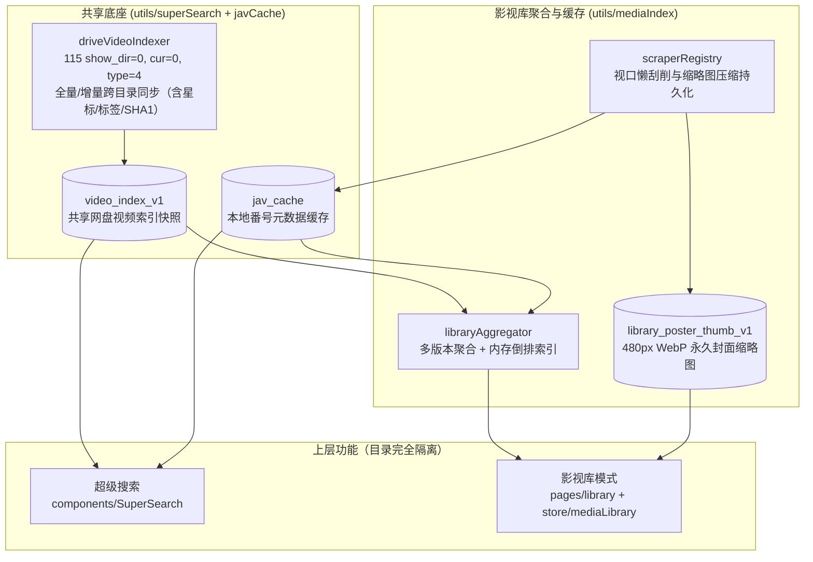

# 115Master Fusion「影视库模式（Media Library）」产品与技术说明书

> **文档状态**：草案 v1.1（已完成首页布局与核心交互确认）  
> **适用范围**：U3 Fusion 独立应用新增核心路由 `/#/library`（与文件管理 `/#/drive` 并列，U1/U2 顶栏提供直达入口）  
> **核心目标**：基于 115 网盘文件索引、外部刮削源与本地缓存数据，将 115 网盘转化为类似 Emby / Jellyfin / Infuse 风格的私人影视库——支持海报墙、多维分类筛选、演员墙、影片详情页、一键播放，并面向**番号影视 + 普通电影/剧集**两类资源统一建模（一期交付番号影视，二期扩展普通影视）。

---

## 一、产品背景与定位

当前 115Master Fusion 已具备成熟的 U3 文件管理（`/#/drive`）与 MASTER 播放器（`/#/video`），但本质上仍是以“目录树 + 文件列表”为中心：
- **目录割裂**：同演员、同题材、同年份的作品往往分散在多个不同日期或来源的子目录中，无法按内容维度沉浸浏览。
- **元数据利用率低**：本地已积累了大量 `javCache`（封面、演员、分类、导演）、`actressFaceDB`（演员头像）、`videoCoverCache`（时间轴截图）和 `markerStore`（播放打点），但仅在打开具体文件夹时零星展示。
- **多类型资源并存需求**：用户的网盘里通常同时存在**番号影视**与**普通电影/剧集**，需要一套可扩展的统一影视库框架，在同一个界面里按媒体库分区清晰管理。

---

## 二、产品设计

### 2.1 架构形态：作为 Fusion 独立路由接入（不拆独立脚本）

- **统一入口**：在 U3 Fusion 顶栏/侧边栏新增「影视库（`/#/library`）」导航项，与「文件管理（`/#/drive`）」平级切换；U1/U2 页面可通过 Fusion 入口直达。
- **零侵入与按需初始化**：未进入 `/#/library` 路由时，影视库模块不初始化状态、不占用列表页内存；同时可在偏好设置中提供开关控制入口显隐。
- **媒体库分区（Library Tabs）**：
  - **全部 / 番号影视**（一期默认启用）
  - **普通电影 / 剧集**（二期接入 TMDB 刮削源后启用，支持用户按网盘根目录绑定媒体库类型，例如 `/AV` → 番号库、`/Movies` → 普通影视库）

### 2.2 整体三段式单侧边栏布局（方案 B）与两大核心页面视图

影视库直接复用现有 U3 Fusion 的 **`Layout` + `Sider`（左侧边栏）+ `Header`（顶栏）+ `Main`（中央主区域）** 三段式单侧边栏骨架，与 `/#/drive` 100% 统一，不引入双 Rail 侧边栏，避免挤压海报墙视野并保持轻量化。

```text
+---------------+--------------------------------------------------+
| 单侧边栏 (~220px)| 顶栏：标题/面包屑 | 库内即时搜索 | 排序/视图/刮削 |
| ───────────── +--------------------------------------------------+
| ● 全部作品     | [轻量筛选条（可折叠）：题材 / 年份 / 导演 / 状态 / 打点] |
| ○ 最近入库     |                                                  |
| ○ 有打点       |  ┌─────────┐ ┌─────────┐ ┌─────────┐ ┌─────────┐ |
| ↩ 返回网盘     |  │ 作品封面 │ │ 作品封面 │ │ 作品封面 │ │ 作品封面 │ |
| ───────────── |  │ (悬停播) │ │ (悬停播) │ │ (悬停播) │ │ (悬停播) │ |
| [演员] [题材]  |  └─────────┘ └─────────┘ └─────────┘ └─────────┘ |
| 🔍 过滤...     |  ┌─────────┐ ┌─────────┐ ┌─────────┐ ┌─────────┐ |
| ○ 演员A (48)   |  │ 作品封面 │ │ 作品封面 │ │ 作品封面 │ │ 作品封面 │ |
| ○ 演员B (36)   |  └─────────┘ └─────────┘ └─────────┘ └─────────┘ |
| ───────────── |                                                  |
| 媒体库分区/设置 |          中央主区域：虚拟滚动作品海报墙              |
+---------------+--------------------------------------------------+
```

#### 整体页面骨架分工

- **单侧边栏（`Sider`，~220px，窄屏自动收进抽屉）**：
  - **上半区（固定主导航）**：`全部作品`（默认首页）、`最近入库`、`有打点`（关联本地 `markerStore`）、`返回网盘`（`/#/drive`）。
  - **下半区（内嵌索引联动区）**：轻量切换 Tab（`演员` | `题材`）+ 迷你过滤搜索框 + 紧凑可滚动列表：
    - `演员` Tab：按作品数 / 首字母排序展示已刮削演员，优先匹配 `actressFaceDB` 展示高清圆形头像 + 姓名 + 作品数；
    - `题材` Tab：展示标签名 + 作品数。
  - **联动规则**：未选中具体演员/题材时，右侧保持展示全部作品海报墙；点选某演员或题材后，右侧中央海报墙毫秒级过滤为对应作品集，支持在演员/题材间连续切换而无需整页跳转。
  - **底部区**：媒体库分区切换（二期扩展普通影视）与刮削状态 / 目录绑定设置入口。
- **顶栏（`Header`）**：
  - **左侧**：当前视图标题 / 面包屑（例如选中演员时显示 `演员 / XXX (24部)`，支持一键清除回到全部作品）。
  - **中间**：**库内即时搜索框**（本地内存毫秒级检索番号、片名、演员、题材标签，区别于 115 远程搜索）。
  - **右侧**：排序选择（`最近入库`、`发行日期`、`片长`、`文件大小`、`番号/名称`）、卡片比例切换（横版封面 / 竖版海报）、网格密度调节、刮削进度徽章。
- **中央主区域（`Main`）**：
  - **顶部轻量多维筛选胶囊条**（可折叠）：支持按`媒体类型（全部 / 番号影视 / 普通电影［二期］）`、`题材/分类标签`、`导演`、`发行年份`、`时长区间`、`刮削状态（已刮削 / 待刮削）`、`是否有打点`组合过滤，已选条件以胶囊展示并支持一键清空。
  - **下方主体**：虚拟滚动作品海报墙。

#### 1. 作品海报墙首页（`/#/library`）
- **首页即作品墙**：取消独立的 Hero 大图大厅与独立演员整页视图，进入 `/#/library` 直接展示按作品排布的海报网格，保证高信息密度与开箱即逛。
- **自适应海报网格**：支持横版封面（适合番号宽封面）与竖版海报（适合二期普通电影海报）两种卡片比例切换，支持网格密度调节与虚拟滚动（Virtual Grid）流畅浏览。
- **卡片交互规范**：
  - **主点击（点击卡片主体）**：进入独立影片详情页（`/#/library/item/:mediaKey`）；
  - **快捷播放（悬停按钮）**：鼠标悬停于卡片时浮现 **「直接播放」** 快捷按钮，点击直接进入 MASTER 播放器（`/#/video/:pickCode`）起播。
- **多版本聚合**：同一作品（相同 `avNumber` 或 `tmdbId`）在网盘中存在多个版本（如原画 + 字幕版）时，在海报墙聚合为单张卡片，角标显示版本数与打点状态，详情页可自由切换播放版本。

#### 2. 独立影片详情页（`/#/library/item/:mediaKey`）
- **沉浸式头部**：大图背景高斯模糊 + 高清主封面 + 片名、编号/年份、时长、文件大小、导演、题材标签胶囊。
- **演员横排**：圆形头像 + 姓名，点击可直接带入该演员筛选条件回到海报墙（`/#/library`）。
- **版本与文件信息**：列出该作品对应的全部网盘文件（文件名、大小、清晰度、所在目录），支持一键 **「MASTER 播放」** 或 **「在文件管理中打开目录」**。
- **预览与打点联动（三类图片与时间分段截图衔接）**：
  - **主封面 & 背景大图**：先使用本地永久缓存的 WebP 缩略图瞬时占位防白屏，再异步升级加载高清原图（走现有 `imageCache` LRU 缓存）；
  - **官方预览剧照**：展示 `JavInfo.preview` 剧照画廊，按需加载并走 `imageCache`，点击可调用现有 `ImagePreviewer` 查看大图；
  - **时间分段截图（复用 `videoCoverCache`）**：按当前所选文件版本的 `sha1` 优先命中本机 `video_cover_cache_v1`（`${sha1}_${time}`）秒出历史缓存的时段截图；未命中时复用 `useVideoCover` / `ExtVideoCover` 按需抽取并持久化；点击任意截图直接跳转 MASTER 播放器从对应 `seekTime` 起播；
  - **已保存打点**：展示 `markerStore` 中该影片的打点列表，点击打点直接从对应时间点起播。
- **元数据管理**：支持「重新刮削」「手动指定番号/片名纠正」「隐藏/忽略该文件」。
- **状态与位置记忆**：从详情页返回 `/#/library` 时，**保留海报墙滚动位置、侧边栏选中项（主导航 / 演员 / 题材）与当前筛选/搜索条件**，避免浏览中断。

---

## 三、技术架构与统一数据模型

### 3.1 直接复用 v2.7.13「超级搜索」跨目录索引底座

`v2.7.13` 已上线 `utils/superSearch` 跨目录索引引擎与 `video_index_v1` IndexedDB 快照存储。为避免重复扫盘与同库读写冲突，影视库直接复用其底层索引与存储层（同时向后兼容扩展 `IndexedVideo.sha1` 以命中本地时间分段截图缓存），上层聚合与缩略图持久化放在 `apps/monkey/src/utils/mediaIndex/`：



### 3.2 面向两类视频的统一元数据模型

一期直接复用 `javCache`，二期通过统一抽象接口 `MediaItem` 兼容普通电影/剧集，UI 组件无需重写：

```ts
export type MediaKind = 'jav' | 'movie' | 'tv' | 'unknown'

/** 影视库目录配置：决定某个网盘根目录按哪种类型刮削 */
export interface MediaSourceFolder {
  cid: string
  name: string
  kind: 'auto' | 'jav' | 'movie' | 'tv'
  enabled: boolean
}

/** 统一影视元数据实体（屏蔽 JavInfo 与 TMDB 差异） */
export interface UnifiedMediaMeta {
  /** 唯一键：如 "jav:SSIS-001" 或 "tmdb:movie:550" */
  mediaKey: string
  kind: MediaKind
  /** 外部标识（番号或 TMDB ID） */
  externalId: string
  title: string
  originalTitle?: string
  overview?: string
  /** 横版封面 / 竖版海报 / 背景大图 / 官方预览剧照 */
  coverUrl?: string
  posterUrl?: string
  backdropUrl?: string
  previews?: Array<{ thumbnail?: string, raw?: string }>
  releaseDate?: string
  year?: number
  duration?: number
  rating?: number
  directors: string[]
  actors: Array<{ name: string, url?: string, avatarUrl?: string }>
  genres: string[]
  source: string
  detailUrl?: string
  updatedAt: number
}

/** 影视库聚合条目：1 份元数据 + N 个网盘视频文件 */
export interface LibraryEntry {
  mediaKey: string
  kind: MediaKind
  meta: UnifiedMediaMeta | null
  files: Array<{
    fid: string
    cid: string
    pickCode: string
    /** 文件 SHA1（旧快照缺失时详情页按需调用 getFilesVideo 兜底补全），用于命中 videoCoverCache */
    sha1?: string
    name: string
    size: number
    duration: number
    mtime: number
    starred?: boolean
    labels?: Array<{ id: string, name: string, color?: string }>
  }>
  latestMtime: number
  markerCount: number
  totalSize: number
  maxDuration: number
  starred: boolean
  driveLabels: Array<{ id: string, name: string, color?: string }>
}
```

### 3.3 8,000 部视频的三层渐进式刮削策略

为避免对外部站点发起大量并发请求导致风控或封 IP，刮削引擎分为三层：

1. **第一层：秒级建骨架（0 外部请求，3–5 秒）**
   - 复用 `DriveVideoIndexer` 通过 115 `show_dir: 0, type: 4` 分页拉取所有视频（8,000 部约 7–8 次请求）；
   - 自动识别类型：`getAvNumber()` 命中则归为 `jav`；未命中且位于普通影视目录则归为 `movie`/`tv`（二期）；
   - 立即与本地已有的 `javCache`、`markerStore`、`actressFaceDB` 关联，已浏览过的影片秒出大图与完整分类。
2. **第二层：视口按需懒刮削（IntersectionObserver + 低并发调度器）**
   - 海报墙仅对当前进入视口且 `meta === null` 的卡片入队刮削；
   - 复用仓库现有 `Scheduler` 限制最大并发 `maxConcurrent = 2`，滚出视口立即取消等待队列任务；
   - 刮削结果持久化到 IndexedDB，下次打开秒开。
3. **第三层：可选后台慢速补全队列**
   - 影视库顶部提供「刮削中心」浮层：展示 `已刮削 / 总计 / 失败数`；
   - 用户可手动点击「后台补全」，按低速节流（例如每 800–1200ms 1 部，遇 429/验证码自动退避暂停）逐步补齐未刮削条目，支持随时暂停与断点续传。

### 3.4 本地内存倒排索引（保证 8,000 条秒级筛选）

页面初始化时将 IndexedDB 中的 `video_index_v1` 与 `javCache` 聚合构建为内存倒排索引（耗时 < 80ms）：
- `byActor: Map<string, Set<mediaKey>>`
- `byGenre: Map<string, Set<mediaKey>>`
- `byYear: Map<number, Set<mediaKey>>`
- `byDirector: Map<string, Set<mediaKey>>`

多维组合筛选仅需对多个 `Set` 求交集，8,000 部影片的任意条件组合过滤均在 **2 毫秒内**完成，配合虚拟滚动（Virtual Grid）保证 60fps 流畅浏览。

### 3.5 本机持久化缓存与存储体积控制

为兼顾「离线/弱网秒开海报墙」与「本机浏览器磁盘占用可控」，采用按资源分层持久化策略：

- **元数据与网盘索引（`video_index_v1`、`jav_cache`）**：全量长期持久化在本机 IndexedDB（不设时间过期；8,000 部约 15–25 MB），支持零外部请求秒级离线筛选。
- **海报墙封面缩略图（独立缩略图存储）**：首次抓取封面成功后，前端经 Canvas 压缩转存为宽约 `480px` 的 **WebP 缩略图** 永久缓存（单张约 20–30 KB，8,000 部总计约 **160–240 MB**），确保源站挂掉或未开代理时海报墙依然秒开且滚动解码更轻量。
- **详情页高清原图 / 官方预览剧照**：进详情页时按需加载，复用现有 `imageCache` 配合 `QuotaManager`（达到配额 80% 阈值时触发 LRU 自动淘汰）。
- **时间分段截图**：复用现有 `videoCoverCache`（IndexedDB Store `video_cover_cache_v1`，键格式 `${sha1}_${time}`），详情页优先命中历史已截取的时段预览帧，未命中再通过 `useVideoCover` 按需抽取并回写缓存。
- **浏览器存储持久化保护**：影视库首次初始化时可尝试调用 `navigator.storage.persist()` 向浏览器申请持久化存储权限，降低系统磁盘紧张时被自动清理 IndexedDB 的风险。

---

## 四、目录结构与现有模块集成

```text
apps/monkey/src/
├── utils/superSearch/                # v2.7.13 跨目录视频索引底座（与超级搜索共享）
│   ├── videoIndexStore.ts            # video_index_v1 持久化与内存表
│   └── driveVideoIndexer.ts          # 115 show_dir=0, cur=0, type=4 全量/增量同步（含 sha1/星标/标签）
├── utils/mediaIndex/                 # 影视库专用聚合、缩略图永久缓存与刮削适配
│   ├── videoIndexStore.ts            # 透传共享索引读写 + library_poster_thumb_v1 WebP 永久缓存
│   ├── scraperRegistry.ts            # 刮削器适配与 480px WebP 缩略图压缩持久化
│   └── libraryAggregator.ts          # 聚合多版本文件 + 元数据 + 打点 + 星标/标签 + 倒排索引
├── store/mediaLibrary.ts             # 影视库 Pinia Store（增量同步、视口懒刮削与状态记忆）
└── pages/library/                    # 影视库独立页面模块（路由 /#/library、/#/library/item/:mediaKey）
    ├── index.vue                     # 影视库主布局（单侧边栏 + 作品海报墙，离开/返回保留滚动位置）
    ├── detail.vue                    # 独立影片详情页（复用封面/剧照、时间分段截图、打点与播放）
    └── components/
        ├── LibrarySider.vue          # 单侧边栏（主导航 + 演员/题材 Tab 联动 + 增量/全量同步）
        ├── LibraryHeader.vue         # 顶栏面包屑、库内即时搜索与排序/视图工具
        ├── FilterBar.vue             # 轻量多维筛选胶囊条
        ├── PosterGrid.vue            # 虚拟滚动海报墙（视口按需入队/取消刮削）
        └── PosterCard.vue            # 作品卡片（点击进详情、悬停快捷直接播放、星标/打点角标）
```

### 复用现有模块清单
- **跨目录视频索引**：[`apps/monkey/src/utils/superSearch/driveVideoIndexer.ts`](../apps/monkey/src/utils/superSearch/driveVideoIndexer.ts)、[`apps/monkey/src/utils/superSearch/videoIndexStore.ts`](../apps/monkey/src/utils/superSearch/videoIndexStore.ts)
- **115 API**：[`packages/drive115/src/clients/file/client.ts`](../packages/drive115/src/clients/file/client.ts)、[`packages/drive115/src/clients/video/client.ts`](../packages/drive115/src/clients/video/client.ts)
- **番号识别**：[`apps/monkey/src/utils/getNumber.ts`](../apps/monkey/src/utils/getNumber.ts)
- **番号刮削与缓存**：[`apps/monkey/src/utils/jav/loadInfo.ts`](../apps/monkey/src/utils/jav/loadInfo.ts)、[`apps/monkey/src/utils/cache/javCache.ts`](../apps/monkey/src/utils/cache/javCache.ts)
- **演员头像库**：[`apps/monkey/src/utils/actressFaceDB.ts`](../apps/monkey/src/utils/actressFaceDB.ts)
- **打点与截图**：[`apps/monkey/src/utils/cache/markerStore.ts`](../apps/monkey/src/utils/cache/markerStore.ts)、[`apps/monkey/src/hooks/useVideoCover/index.ts`](../apps/monkey/src/hooks/useVideoCover/index.ts)
- **路由与播放器**：[`apps/monkey/src/app/router.ts`](../apps/monkey/src/app/router.ts)、[`apps/monkey/src/pages/video/index.vue`](../apps/monkey/src/pages/video/index.vue)

---

## 五、分期实施路线图

| 阶段 | 交付内容 | 说明 |
|---|---|---|
| **Phase 1（番号影视库 MVP）** | 共享 `mediaIndex` 扁平索引 + `/#/library` 路由 + 三段式单侧边栏（主导航 + 演员/题材 Tab 联动列表）+ 首页作品海报墙（虚拟滚动、多维筛选与库内即时搜索、点卡片进详情 / 悬停直接播放）+ 独立影片详情页（联动播放、打点、预览截图，返回保留滚动位置与筛选态）+ 视口按需懒刮削 | 复用现有全部番号刮削源与缓存，零额外配置即可开箱使用 |
| **Phase 2（普通影视支持）** | 引入 `TmdbScraper`（支持用户配置免费 TMDB API Key + 代理/反代选项）+ 电影/剧集文件名解析器（片名/年份/季集 `S01E01`）+ 媒体库目录分类绑定（AV 目录 vs 电影/剧集目录）+ 竖版海报与季集详情排版 | 真正实现「番号影视 + 普通电影/剧集」双库并存 |
| **Phase 3（体验与管理增强）** | 后台低速补全队列（断点续传/风控退避）、手动匹配纠正元数据、自定义片单/收藏夹、与超级搜索结果直达详情页联动 | 打造完整私人影音中心体验 |
