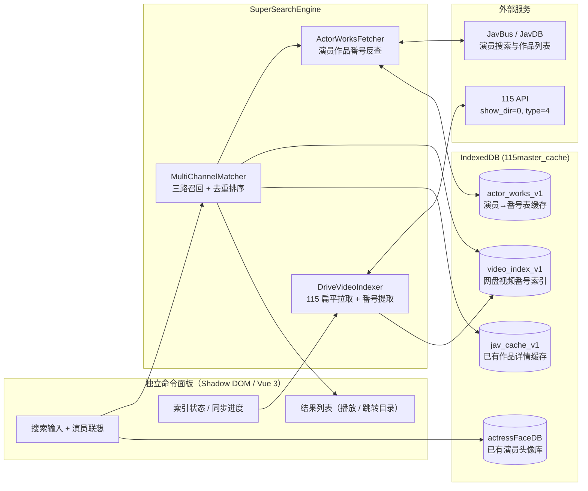

# 115Master Fusion「超级搜索（Super Search）」产品与技术说明书

> **文档状态**：草案 v1.0  
> **适用范围**：115Master Fusion（U1 115 旧版 / U2 115 新版 / U3 Fusion 独立界面）  
> **核心目标**：让用户在网盘文件名/文件夹名**不含目标关键字**的情况下，依然能够通过演员姓名、作品标签、导演、番号等元数据，秒级检索出网盘中已收藏的对应视频。

---

## 一、产品背景与痛点

115 官方原生搜索仅支持**基于文件/文件夹名称的字面匹配**。在影视收藏场景下存在明显短板：
- **文件名信息残缺**：大量网盘视频文件名仅包含番号（如 `www.98T.la@SSIS-001.mp4`），不含演员名、片名或题材标签，且深藏在多层子文件夹/子子文件夹中。
- **跨目录查找困难**：即便在目录浏览时脚本能展示番号资料卡片，用户仍无法回答“我网盘里到底存了某位演员的哪几部片？”这类全局问题。
- **正向刮削不可行**：用户网盘常有数千至上万个视频（典型规模约 8,000 部），若逐个向外部站点请求元数据建立正向索引，耗时极长且必然触发防爬与风控。

---

## 二、产品设计

### 2.1 入口与形态：独立命令面板（不侵入官方搜索框）

采用类似 Spotlight / Command Palette 的**独立隔离弹窗组件**，与现有「偏好设置」弹窗复用同一套 Shadow DOM 挂载机制，**不劫持或改造 115 官方搜索框**：
- **工具栏入口**：
  - **U1 旧版**：挂载在面包屑栏右侧 `.master-topbar-cluster` 分段按钮组中（新增「搜索」按钮）。
  - **U2 新版**：挂载在 `OfficialPage` 工具栏按钮组 `.controls` 中。
  - **U3 Fusion**：挂载在顶栏操作区。
- **快捷键唤起**：支持全局快捷键（建议 `Alt + K` 或 `Shift + /`，刻意避开 115 官方占用的 `Cmd/Ctrl + K`），按 `Esc` 关闭，不破坏当前目录与滚动位置。

### 2.2 核心功能模块

#### 1. 网盘视频索引管理（顶部状态栏）
- 展示当前索引摘要：例如 `已索引 8,120 个视频（识别番号 7,640 部）· 更新于 2 小时前`。
- **索引范围配置**：
  - 默认扫描整个网盘（`cid = '0'`），支持用户指定一个或多个“影视根目录”以彻底跳过工作文档、照片备份等无关目录。
- **自动过滤非目标文件**：
  - 仅拉取视频文件（服务端 `type=4`），图片、压缩包、文档、字幕自动忽略；
  - 建索引时通过 `getAvNumber()` 提取番号，无法识别番号的普通视频（生活录屏、普通电影等）仅保留文件名用于字面兜底，不参与演员反向查询。
- **手动增量/全量刷新**：提供「更新索引」按钮与实时进度条（已拉取页数 / 视频数），支持取消与断点续扫。

#### 2. 多维度检索能力
用户在搜索框输入关键词后，系统同时执行**三路召回并合并去重**：

| 召回通道 | 触发方式 | 典型查询示例 | 耗时 |
|---|---|---|---|
| **通道 A：演员反向作品匹配（核心）** | 输入演员名 → 在线查演员作品番号表 → 与本地网盘番号索引求交集 | `松下纱荣子`、`三上悠亚` | 首次 1–3s，命中缓存 < 10ms |
| **通道 B：本地 `javCache` 元数据反查** | 扫描本地已浏览缓存的作品介绍（演员 / 标题 / 分类 / 导演 / 年份）→ 匹配本地网盘索引 | `剧情`、`中文字幕`、`2024`、导演名 | < 20ms |
| **通道 C：网盘文件名 / 番号直搜** | 本地索引中按番号规范化值或文件名子串模糊匹配 | `SSIS-001`、`FC2-4853836`、`无码流出` | < 5ms |

- **演员候选联想**：输入时可结合本地 `actressFaceDB` 演员库提供带头像的下拉联想，减少手动拼写与繁简/日文名误差。

#### 3. 搜索结果展示与快捷操作
- **结果卡片信息**：
  - 视频封面/海报（命中 `javCache` 时直接展示，未命中时按需懒加载）、标准化番号、原始文件名、视频时长与文件大小；
  - **命中原因标签**：如 `演员匹配 · 松下纱荣子`、`标签匹配`、`文件名匹配`；
  - **重复文件折叠**：若同一番号在网盘中存在多个版本（如原画版 + 字幕版），聚合展示或标记多版本。
- **快捷操作**：
  - **直接播放**：一键调用 MASTER 播放器打开该视频（直接复用 `pickCode`）；
  - **定位所在目录**：跳转到该视频所在的子文件夹（`cid`），方便整理、移动或删除；
  - **查看作品详情**：展开完整番号资料卡片。

---

## 三、技术架构与核心原理

### 3.1 为什么快且不触发风控：「反向求交集」架构

- **传统正向刮削（不可行）**：8,000 个视频 → 发起 8,000 次外部请求查询每个视频的演员 → 极慢且必封 IP。
- **反向求交集（本方案）**：
  1. **网盘建索引（0 次外部请求）**：利用 115 API 原生跨子目录扁平拉取参数 `show_dir: 0` + `type: 4`，每页最多 1,150 条。**8,000 个视频无论嵌套多少层子目录，仅需 7–8 次分页请求（约 3–5 秒）即可拉完**；
  2. **本地正则提取番号**：调用现有 [`getAvNumber`](../apps/monkey/src/utils/getNumber.ts)（247 行纯同步正则）为所有视频提取标准化番号，耗时几十毫秒；
  3. **搜索时反向查演员（2–5 次外部请求）**：输入演员名后，仅向外部源（JavBus / JavDB）查询该 1 位演员的个人作品列表页（通常 1–5 页），拿到其全部作品番号集合 `Set<string>`；
  4. **本地内存毫秒级求交集**：用演员番号集合在本地 `Map<avNumber, VideoRecord[]>` 中直接查表，**< 1 毫秒**完成 8,000 条视频的精确筛选。

### 3.2 系统架构图



### 3.3 一次演员搜索的时序流程

```mermaid
sequenceDiagram
  actor User as 用户
  participant Panel as SuperSearchDialog
  participant Index as DriveVideoIndexer
  participant Actor as ActorWorksFetcher
  participant Jav as JavBus / JavDB

  User->>Panel: 输入「松下纱荣子」并回车
  par 本地通道（< 20ms 立即出首屏结果）
    Panel->>Index: 通道 B：扫描 javCache 中演员/标签/标题命中
    Panel->>Index: 通道 C：匹配本地文件名与番号
    Index-->>Panel: 返回已缓存命中项（先渲染）
  and 在线演员反向通道（1–3s 增量补全）
    Panel->>Actor: 查询「松下纱荣子」全部作品番号
    alt 命中 actor_works_v1 缓存且未过期
      Actor-->>Panel: 直接返回番号集合 Set
    else 缓存未命中
      Actor->>Jav: 搜索演员主页 URL
      Jav-->>Actor: 返回演员页（含别名/作品数）
      Actor->>Jav: 分页拉取作品列表（1–5 页，串行限速）
      Jav-->>Actor: 返回全部标准化番号 Set
      Actor->>Actor: 写入 actor_works_v1（TTL 7 天）
      Actor-->>Panel: 返回番号集合 Set
    end
    Panel->>Index: 本地 Map 求交集（< 1ms）
    Index-->>Panel: 返回全盘匹配视频列表（合并去重后刷新 UI）
  end
```

---

## 四、数据模型与存储设计

复用 [`CacheCore`](../packages/shared/src/cache/core.ts) 与统一数据库名 `STORE_NAME`（`115master_cache`），新增两个轻量对象仓库：

### 4.1 网盘视频索引表（`video_index_v1`）

```ts
export interface IndexedVideo {
  /** 115 文件 ID（主键） */
  fid: string
  /** 所在父目录 ID（用于一键跳转目录） */
  cid: string
  /** 提取码（用于直接拉起 MASTER 播放器） */
  pickCode: string
  /** 原始文件名 */
  name: string
  /** 标准化番号（如 "SSIS-001"），无法识别时为 null */
  avNumber: string | null
  /** 文件大小（字节） */
  size: number
  /** 视频时长（秒） */
  duration: number
  /** 115 修改时间戳（秒），用于增量同步比对 */
  mtime: number
}

export interface VideoIndexSnapshot {
  /** 索引版本，用于结构升级 */
  schemaVersion: 1
  /** 扫描的根目录 cid 列表，默认 ['0'] */
  rootCids: string[]
  /** 上次全量同步时间 */
  lastFullSyncAt: number
  /** 上次增量同步时间 */
  lastSyncAt: number
  /** 扁平视频列表 */
  items: IndexedVideo[]
}
```

- **存储体积估算**：每条 `IndexedVideo` 约 180–220 字节，8,000 条视频序列化后约 **1.6 MB**，10,000 条约 **2 MB**，远低于浏览器 IndexedDB 配额，全量读入内存建立 `Map<avNumber, IndexedVideo[]>` 耗时 **< 50ms**。

### 4.2 演员作品表缓存（`actor_works_v1`）

```ts
export interface ActorWorksCacheEntry {
  /** 规范化演员名（主键） */
  actorKey: string
  /** 展示名与已知别名 */
  name: string
  aliases: string[]
  /** 来源站点（javbus / javdb） */
  source: 'javbus' | 'javdb'
  /** 演员详情页链接 */
  profileUrl: string
  /** 标准化后的全部作品番号列表 */
  avNumbers: string[]
  /** 缓存时间（建议 TTL 7 天，支持用户手动刷新） */
  cachedAt: number
}
```

---

## 五、核心模块与关键算法设计

### 5.1 网盘扁平索引同步器（`DriveVideoIndexer`）

1. **全量拉取**：
   - 复用 [`drive115.file.getFilesWithFallback`](../packages/drive115/src/clients/file/client.ts#L12-L35)，固定参数：
     ```ts
     { cid: rootCid, show_dir: 0, type: 4, limit: 1150, offset, o: 'user_ptime', asc: 0 }
     ```
   - 每页间隔 `200–300ms` 串行翻页，直至返回条数 `< limit` 或达到 `count`。
   - 对每条文件执行 `normalizeAvNumber(getAvNumber(item.n))`，生成 `IndexedVideo`。
2. **增量更新（快速刷新）**：
   - 因按 `user_ptime` 降序拉取，增量同步只需从第 1 页开始拉取，遇到 `mtime <= lastSyncAt` 即可提前停止，日常刷新仅需 **1 次请求（< 500ms）**。
   - 若用户删除了大量旧文件，提供「重建索引」触发全量覆写。
3. **可选的父目录名番号兜底（二期）**：
   - 对于 `avNumber === null` 的极少数视频（例如 `SSIS-001/1.mp4`），可按需收集其去重后的 `cid` 列表，查询目录名再执行一次 `getAvNumber(dirName)`。

### 5.2 演员作品反查器（`ActorWorksFetcher`）

1. **复用现有跨域请求与解析基础设施**：
   - 基于 [`GMRequest`](../apps/monkey/src/utils/request/gmRequest.ts) 发起跨域抓取，复用现有 `@connect` 白名单域名（`javbus.com`、`javdb.com`）。
2. **显式触发与防风控护栏（Phase 2）**：
   - **显式触发（禁止随输入自动抓取）**：仅在用户按下 `Enter`、点击「反查演员」按钮或选中 `actressFaceDB` 头像下拉建议时发起通道 A 请求，输入过程中的实时匹配仅走本地通道 B/C。
   - **多源降级与别名处理**：优先查询 `JavBus`，未命中或异常时自动降级至 `JavDB`；结果按 `normalizeActressName` 归一化所有已知别名写入 `actor_works_v1`（TTL 7 天）。
   - **保守翻页与随机抖动**：首轮最多拉取前 **5 页**（超出部分需用户点击「加载更多」继续，单演员硬上限 15 页），页间延时 **650–950ms**（`650ms + 0–300ms` 随机抖动）。
   - **5 分钟数据源熔断器**：遇到 `403` / `429` / `503`、Cloudflare 质询或 `JavDB` 登录墙时立即熔断当前来源 **5 分钟** 并自动切换降级源或回退本地结果，不做盲目重试。
   - **禁止列表页并发补拉详情**：命中的视频若尚未进入本地 `javCache`，仅展示索引元数据（番号、文件名、时长、大小），不在结果列表中批量正向刮削封面或详情。
   - 提取出的每个作品番号统一经过 `normalizeAvNumber(getAvNumber(text) ?? text)` 处理，确保与本地索引键格式 100% 一致。

### 5.3 三路召回与排序策略（`MultiChannelMatcher`）

对同一 `fid` 去重后，按以下优先级排序：
1. **番号精确命中**（用户输入本身就是番号）；
2. **演员反向精确命中**（来自 `ActorWorksFetcher` 与 `javCache` 双重验证）；
3. **本地元数据命中**（标题 / 导演 / 分类标签命中 `javCache`）；
4. **文件名子串命中**（兜底召回普通视频或素人视频）。

同优先级内默认按 `mtime`（最新入库优先）或文件大小排序，支持在弹窗内一键切换。

---

## 六、代码目录与三端集成方案

### 6.1 建议目录结构

```text
apps/monkey/src/
├── components/SuperSearch/
│   ├── showSuperSearchDialog.tsx     # Shadow DOM 独立弹窗入口（同 showPreferencesDialog）
│   ├── SuperSearchDialog.vue         # 弹窗壳层、快捷键监听、索引状态栏
│   ├── SuperSearchResultItem.vue     # 结果行（封面、命中标签、播放/跳目录按钮）
│   └── useSuperSearch.ts             # 搜索状态机、三路召回调度、防抖与取消
└── utils/superSearch/
    ├── videoIndexStore.ts            # IndexedDB video_index_v1 封装 + 内存 Map
    ├── driveVideoIndexer.ts          # 115 show_dir=0&type=4 扁平全量/增量同步
    ├── actorWorksFetcher.ts          # JavBus / JavDB 演员作品列表反查与缓存
    ├── matcher.ts                    # 三路召回、交集计算与去重排序
    └── __tests__/                    # 单元测试（matcher / indexer / fetcher）
```

### 6.2 三端接入点
- **U1 旧版**：[`TopHeaderMod/index.ts`](../apps/monkey/src/pages/home/TopHeaderMod/index.ts) 在 `.master-topbar-cluster` 增加「搜索」按钮，点击调用 `showSuperSearchDialog()`；
- **U2 新版**：[`pages/official/index.ts`](../apps/monkey/src/pages/official/index.ts) 在 `.controls` 增加「搜索」按钮；
- **U3 Fusion**：在主界面顶栏挂载同一入口；
- **播放与目录跳转**：
  - 播放：直接复用现有 `openVideoPlayer(pickCode)` 路由/播放器打开逻辑；
  - 跳转目录：按当前所处界面（U1 / U2 / U3）构造对应目录 URL（如 `https://115.com/?cid=${cid}&offset=0&mode=wangpan` 或 `https://115.com/storage/allfiles?cid=${cid}` 或 `#/drive/${cid}`）。

---

## 七、风险与边界情况处理

| 风险点 | 影响 | 缓解策略 |
|---|---|---|
| **115 接口频控** | 极端大网盘（5 万+ 视频）连续翻页可能触发限流 | 强制单页 `limit=1150` + 页间 `250ms` 节流；支持指定影视根目录缩小范围；日常走增量同步 |
| **外部站点不可达 / Cloudflare** | 演员在线反查失败 | 通道 B（本地 `javCache`）与通道 C（文件名直搜）始终毫秒级先行返回；外部源支持 JavBus → JavDB 自动降级并提示失败原因 |
| **演员改名 / 繁简差异** | 搜中文译名匹配不到日文原名 | 结合 `actressFaceDB` 联想 + 演员页别名字段归一化；结果缓存按所有别名建映射 |
| **文件名无番号（番号在文件夹名）** | 扁平拉取无法直接识别番号 | 二期增加“父文件夹名番号兜底”开关，仅对 `avNumber === null` 的孤立目录补查一次 |
| **同一番号多版本文件** | 结果列表出现重复条目 | 同一 `avNumber` 命中多个 `fid` 时默认分组折叠展示，标注清晰度/大小便于选择 |

---

## 八、分期实施路线图

| 阶段 | 状态 | 交付内容 | 预期价值 |
|---|---|---|---|
| **Phase 1（MVP）** | ✅ 已完成 | 独立搜索弹窗 + `DriveVideoIndexer`（`show_dir=0, type=4` 扁平索引）+ 本地 `javCache` 元数据反查 + 文件名/番号直搜 + 三端入口与快捷键 | 零外部风控风险，立刻实现全盘 8,000 视频毫秒级番号/已刮削元数据检索、一键播放与跳目录 |
| **Phase 2（核心增强）** | ✅ 已完成 | 接入 `ActorWorksFetcher`（JavBus / JavDB 演员作品表反查 + 7 天缓存 + 显式触发 / 5 页上限 / 650–950ms 抖动 / 5 分钟熔断 / 禁止批量补刮详情）+ 内存交集匹配 + `actressFaceDB` 头像联想 | **完全实现目标能力**：从未浏览过的目录也能按演员名全盘零遗漏命中，同时严控外部站点反爬风险 |
| **Phase 3（体验完善）** | ⏸️ 暂不实施（Deferred） | 增量定时/快捷刷新、指定扫描目录白名单、父文件夹名番号兜底、按分类/年份/时长筛选 | 涉及较高频的 115 目录/定时接口调用（尤其是父文件夹兜底与后台轮询），按当前规划暂缓实施 |
